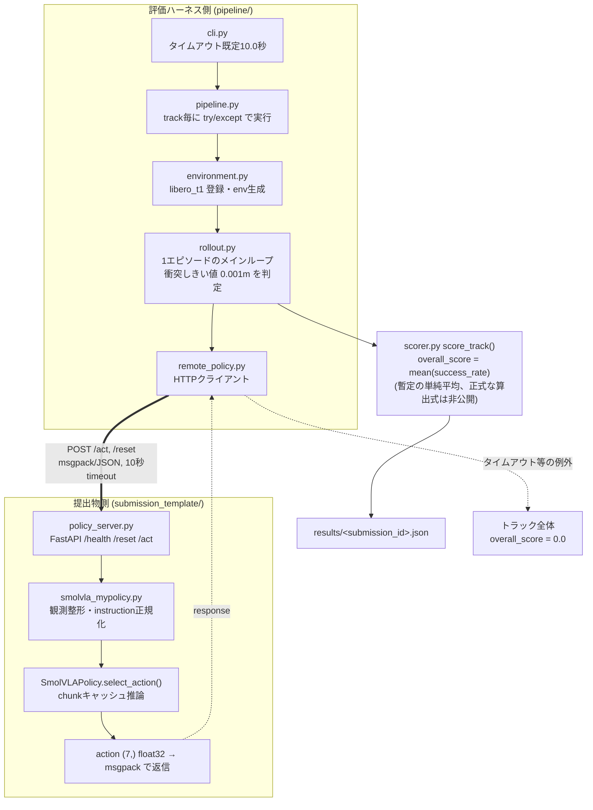
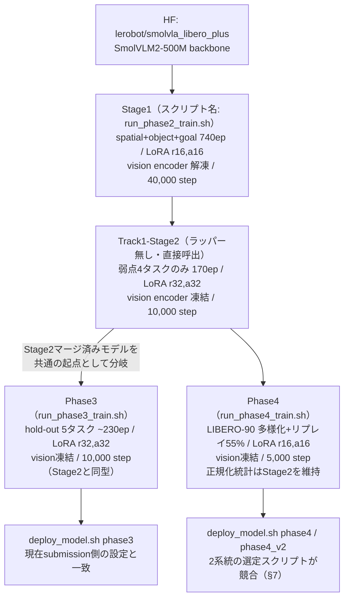
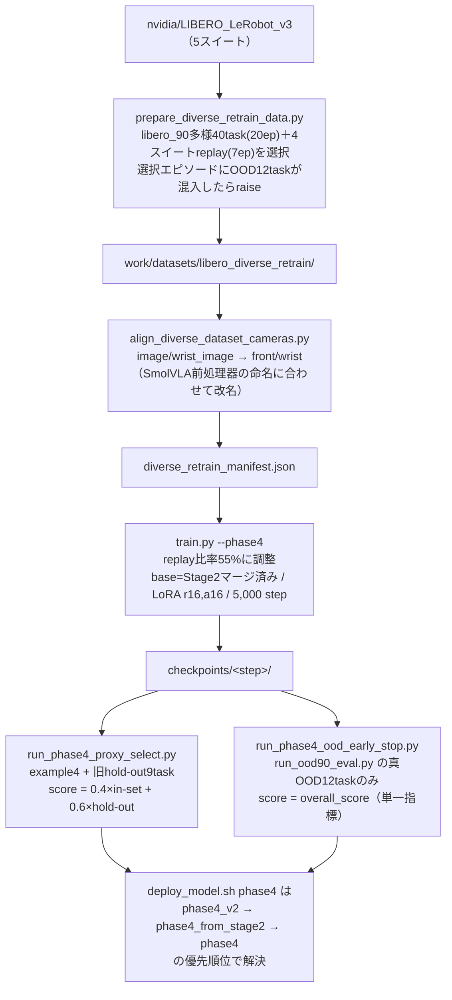

# PARC2026 予選配布環境 ― パイプライン解剖と開発変遷

> **Code-verified architecture report**
> README等のドキュメントは一次情報として扱わず、`pipeline/`・`compe/`・`submission_template/`・`examples/smolvla_libero_spatial_lora_local/`配下の実コードを直接読み、制御フローとデータフローを検証したうえでの報告である。

| | |
|---|---|
| 対象リポジトリ | PARC2026_pre_env |
| ベンチマーク | LIBERO-plus / LIBERO-90 |
| 提出物形式 | HTTP ポリシーサーバー（SmolVLA + LoRA） |
| コミット数 | 5（`e1ee394` 〜 `0503f12`） |

---

## 00. 要旨

本リポジトリは、ロボット操作ベンチマーク LIBERO を用いた PARC2026 予選のための「配布環境」であり、二つの独立した役割を持つコードベースが同居している。一つは**採点そのものを再現する評価ハーネス**（`pipeline/` 以下、本番と同一ロジック）、もう一つは**参加者（本プロジェクトの場合は開発者自身）が学習・提出物構築に使う作業場**（`examples/smolvla_libero_spatial_lora_local/`）である。5回のコミット履歴を読むと、後者が「LoRA微調整 → 評価 → instructionの言い回しズレの発見 → paraphrase対策 → LIBERO-90への汎化学習」という順で段階的に拡張されてきたことがコード差分から確認できる。

コードを直接読んだ結果、README の記述（10秒タイムアウト、1mm衝突判定など）は実装と数値・ロジックともに一致することを確認した。一方で README や設計メモ（`.cursor/rules/`）だけでは分からない実装上の細部も複数発見した。詳細は [§8](#08-コード精読で判明した相違点注意点) にまとめる。なお、これらの一部は開発者本人による確認の結果、「バグ」ではなく意図された設計であることが判明している（§8冒頭の注記を参照）。

---

## 01. プロジェクトの概要

PARC2026 予選 Track 1 は、**参加者が実装したポリシーを HTTP サーバーとして起動し**、審査側が LIBERO シミュレーション環境からの観測を送り、返ってきたアクションでロボットを動かして採点する形式である。提出物は Python コード一式ではなく、`/health` `/reset` `/act` の3エンドポイントを実装した zip（HTTPサーバー一式）そのものであり、採点側はこのサーバーをブラックボックスとして呼び出す。

このリポジトリで実際に採用されているポリシーは、Hugging Face の `lerobot/smolvla_libero_plus`（VLM バックボーン: SmolVLM2-500M-Video-Instruct）を基盤とし、**LoRA**（Low-Rank Adaptation）で段階的に追加学習した SmolVLA モデルである。学習は4段階（コード上は `Stage1 → Track1-Stage2 → Phase3 → Phase4`、詳細は [§5](#05-学習パイプライン--stage1-から-phase4-まで)）にわたって行われ、各段階の LoRA アダプタは都度ベースモデルへ**マージ**（統合）されて次段階の起点になる。

### ディレクトリの役割（コード確認済み）

| パス | 役割 | 本番評価に含まれるか |
|---|---|---|
| `pipeline/` | Track1 評価パイプライン本体（ロールアウト・採点） | 含まれる（本番と同一ロジック） |
| `compe/t1/` | 公開 example 4タスクの登録 | 含まれる（非公開版CSVに差し替え） |
| `compe/proxy/` | ローカル専用の汎化検証タスク集合 | 含まれない（環境変数ゲート、既定オフ） |
| `submission_template/` | 提出物の実体（サーバー・ポリシー・重み） | そのままzip化される |
| `examples/smolvla_libero_spatial_lora_local/` | 学習・データ準備・チェックポイント選定の作業場 | 含まれない（研究者の手元ワークフロー） |
| `validate_submission.py` / `evaluate.py` | 提出前チェック・zip一括評価 | 本番と共通のバリデータ |

> **注記**: 本リポジトリ内には本番の採点環境そのものは含まれていない。評価パイプライン(`pipeline/`)は本番と同一ロジックの再現であり、本番専用の設定（非公開タスクCSV、`total_score_config.json`等）は別途本番環境側に配置される。

---

## 02. 開発の変遷（コミット履歴）

5コミットの差分統計を実際に確認したところ、単なる継続開発ではなく**「評価して → ボトルネックを特定して → 対策コードを足す」を4回繰り返した**形跡が明確に読み取れる。特にスコアが伸び悩んだ2回目のコミット（instructionの言い回しズレ対策）と、直近のLIBERO-90汎化対策は、いずれも「モデルの学習不足」ではなく「評価時の入力表現とのミスマッチ」「未学習分布への汎化」という、学習曲線だけでは見えない問題への対応であった。

```mermaid
timeline
    title 5コミットの発展
    2026-08-04 20:43 : e1ee394 initial commit : LIBERO本体+評価ハーネスの骨格を投入
    2026-08-04 21:22 : bcaef22「4つのスコア全て成功率約70%」 : 初のLoRA重み投入
    2026-08-05 23:01 : 7a3057f スコア0.11621 : Stage1/Stage2学習スクリプト : 提出バリデータ大幅拡張
    2026-08-06 02:21 : f5a59ad スコア0.11996 : instruction言い回しズレ対策 (+28,115行、paraphrase/proxy)
    2026-08-08 03:28 : 0503f12（最新） : PARC2026予備ルール : LIBERO-90多様化再学習(Phase4)一式
```

3回目・4回目でスコアが記録され始め、モデル自体の再学習ではなく **instructionの表記ゆれ対策**（paraphrase/proxy評価、§6）と **未学習タスク分布への汎化**（diverse retrain、§7）という「評価とのミスマッチ解消」に開発の重心が移っていったことが差分行数からも読み取れる。

---

## 03. 評価パイプラインの全体像

`pipeline/` 配下は `python -m pipeline --server-url ... --track track1` というCLIから、環境構築・ロールアウト・HTTP通信・採点・結果保存までを一気通貫で行う。`evaluate.py`／`evaluate.sh` はこの上に「zip展開 → 依存インストール → サーバー起動 → 上記パイプライン呼び出し」を被せたラッパーである。



左右の境界がHTTP通信であり、ここに `remote_policy.py` の `timeout_sec=10.0`（既定値、`cli.py`の`--timeout`由来）が効く。1回でも超過すると`RuntimeError`となり、`pipeline.py`の`try/except`で捕捉されてトラック全体が0点になる――README「1回でも超過するとそのトラック全体が失敗」の記述と実装が一致する。

### ロールアウトと衝突判定の詳細

`rollout.py` の `_run_episode()` は、環境リセット後にダミーアクションを10ステップ実行してシムを落ち着かせ、そのときの各物体位置を基準位置として記録する。各ステップで `d = Σ|現在位置−基準位置|`（xyz各軸絶対値の和）を計算し、対象物体（bddlの`:obj_of_interest`）を除く全物体についてその最大値を追跡する。エピソード終了時に `collided = any(d > 0.001)`、`success = done and not collided` という2行で成否が決まる（`rollout.py:229, 248-249`）。しきい値 `0.001`（1mm）は `total_score.py` の組み込みデフォルト（`total_score.py:19`）であり、リポジトリ内に `total_score_config.json` は存在しないため常にこの値が使われる。

> **検証結果**: README が主張する「10秒タイムアウト」「1mm衝突しきい値」「xyz各軸絶対値の和・最大値で判定」は、いずれも実装（`remote_policy.py` / `rollout.py` / `total_score.py`）と数値・ロジックともに一致することを確認した。

### Track 1 の「example タスク」と「本番タスク」の関係

`compe/t1/register.py` の `register_t1()` は `T1_TASKS.csv`（4行）を読み、LIBERO の `task_maps["libero_t1"]` に登録する汎用的なCSV駆動の実装であり、コード自体はタスク数に依存しない。README の「本番は非公開タスクを含む別のタスクセットで実施される」という主張は、`evaluate.py` が本番コンテナでは `PYTHONPATH` に `/workspace/compe` を追加している（`evaluate.py:160-163`）ことと整合しており、CSVの中身だけを本番用に差し替える設計であることがコードから裏付けられる。

なお、Track1に設定されている摂動（ノイズ）関連コード（`apply_observation_noise` / `apply_action_noise` / `get_perturbed_init_states`）は全パラメータがデフォルト0のため実質no-opであるが、これは**本番でもTrack1に摂動を課さない設計であることを開発者本人が確認済み**であり、意図された挙動である。

---

## 04. 提出物とSmolVLAポリシー

`submission_template/policy_server.py` は FastAPI 製の薄いサーバーで、`MyPolicy` は既に `SmolVLAMyPolicy("model_weights/smolvla_spatial_lora")` に配線済みである（コメントアウトされたランダム行動テンプレートが上に残っているが未使用）。観測は `agentview_image` / `robot0_eye_in_hand_image`（128×128×3 uint8）と関節・EEF姿勢・グリッパー開度を含む辞書で、msgpackでシリアライズされて送受信される。

`SmolVLAMyPolicy.get_action()`（`smolvla_mypolicy.py:562-589`）は画像を反転・レイアウト変換したうえで `SmolVLAPolicy.select_action()` を呼ぶ。LeRobotの**アクションチャンクキャッシュ**（`policy._queues[ACTION]`）が空のときだけ実際の推論が走り、それ以外はキャッシュから取り出すだけなので毎ステップ重い推論をするわけではない。新規チャンクの先頭ステップだけ、あらかじめ調整された係数（`CHUNK_FIRST_STEP_ACTION_SCALE`）で並進・回転量を縮小するヒューリスティックが入っている（グリッパー値は不変）。

`lerobot_bootstrap.py` は zip 同梱の `vendor/lerobot`（採点環境の Python 3.10 向けにパッチ済み）を読み込み可能にするための下準備で、`typing.Self`/`Unpack` のパッチ、`transformers`互換スタブ、全ポリシーconfigの一括importを回避する遅延importの3点を行う。これは lerobot v0.6.0 のソースが Python 3.12 前提の構文（PEP 695ジェネリクス等）を使っているために必要になっている実装である。

> **重みファイルについて**: 本リポジトリの `submission_template/model_weights/smolvla_spatial_lora/` には設定ファイル群のみが存在し、実体である `model.safetensors`（通常数百MB〜1GB規模）は含まれていない。これは**git管理の都合上サイズの大きい推論用重みファイルを意図的に除外している**ためであり、パイプラインの不備ではない。

---

## 05. 学習パイプライン ― Stage1 から Phase4 まで

`examples/smolvla_libero_spatial_lora_local/config.py` に4段階分のハイパーパラメータブロックが定義されており、`train.py` はコマンドラインフラグ（`--stage1` / `--track1-stage2` / `--phase3` / `--phase4`）でそのどれを使うかを切り替える。ここで**シェルスクリプトの名前とconfig側の段階名が一致していない**点に注意が必要で、`run_phase2_train.sh`は実際には`train.py --stage1`を呼んでいる（`config.py`に「phase2」という名のブロックは存在しない）。



**Phase3とPhase4は直列ではなく、どちらもStage2のマージ済みモデルを起点に並行して分岐している**（`config.py:174-175`のコメントは「Stage2以外を起点にするとTrack1/hold-out性能が素のHFモデルまで後退する」と明記）。現在リポジトリにデプロイされているチェックポイント（`model_weights/smolvla_spatial_lora/config.json`）のハイパーパラメータは Stage2/Phase3 型（`freeze_vision_encoder:true, lr:1e-4, decay_steps:10000`）と一致し、Phase4型（5,000 step, lr 5e-5）とは一致しない。

### マージから提出zipまで

`merge_lora.py` は各段階共通で、PEFTの`merge_and_unload()`をCPU上で実行し、マージ後に `lora_` という名のパラメータが1つでも残っていれば`RuntimeError`で止める安全策を持つ（`merge_lora.py:242-245`）。画像特徴量の形状はHWC→CHWに正規化され、前処理・後処理の設定ファイルとともに保存される。`deploy_model.sh <variant>`がこのマージ済みモデルを`rsync`で`submission_template/model_weights/smolvla_spatial_lora/`へコピーし（ポリシーコード自体は上書きしない）、`bundle_submission.sh`がPython 3.10互換パッチを当てた`vendor/lerobot`と合わせて`submission.zip`を組み立てる。

---

## 06. Instructionの言い回しズレ対策とProxy評価

スコア0.116→0.120の間のコミット（`f5a59ad`）で追加された仕組みの動機は、コードから明確に読み取れる。評価時に `/reset` で送られる instruction は bddl ファイルの `(:language ...)` 節の文字列（例:「Pick the akita black bowl...」）であるのに対し、SmolVLA は `lerobot/libero_plus` データセットの task 文字列（ファイル名由来、例:「pick up the black bowl...」）で学習されている。SmolVLA は言語条件付けモデルであり、`_build_lerobot_observation()`が正規化後のinstructionをそのまま`"task"`フィールドとしてモデルに渡す（`smolvla_mypolicy.py:396-419`）ため、この表記ゆれ自体が性能を落とす要因になっていた。

```mermaid
flowchart LR
    IN["評価時 instruction<br/>bddl (:language ...) 由来"] --> NORM["_normalize_instruction()<br/>PARC_INSTRUCTION_MODE で分岐<br/>既定値 = alias"]
    NORM --> RAW["raw: 小文字化のみ"]
    NORM --> LEG["legacy: 旧4タスク表のみ"]
    NORM --> ALIAS["alias（既定）: 完全一致辞書のみ"]
    NORM --> GEN["generic: alias+書換規則"]
    NORM --> MATCH["match: ＋TF-IDF分類器"]
    ALIASDATA["instruction_aliases.py<br/>静的dict（5,993行）"] --> ALIAS
    ALIASDATA --> GEN
    PARADATA["paraphrase_model.py<br/>TF-IDF最近傍セントロイド<br/>（ニューラルネットではない）"] --> MATCH
    RAW --> OUT["SmolVLA \"task\" 入力"]
    LEG --> OUT
    ALIAS --> OUT
    GEN --> OUT
    MATCH --> OUT
```

既定は最も保守的な `alias`（完全一致辞書のみ、未知の文字列はそのまま通す＝「本番安全モード」）であり、学習ずみのTF-IDF分類器を使う `match` モードは環境変数で明示的にオンにしない限り使われない。`eval_paraphrase_ood.py` は未知タスク（libero_90 90件）への誤マッチ率≤2%を保ちながら既知2,000件の言い換えの受理率を最大化する `score_min` / `margin_min` を探索している。

### paraphrase_model.py の正体

ファイル名やdocstringだけを見るとニューラルネットのように見えるが、実際に生成物の先頭を確認すると**純粋な2つのdictリテラル**（`IDF: dict[str, float]` と `CENTROIDS: dict[str, dict[str, float]]`）であり、クラス定義やforward関数は存在しない。学習（`build_paraphrase_model.py`の`train()`）は bddl の言い換えバリアント約2,000件から TF-IDF ベクトルを作り、正規タスクごとに平均化した**セントロイド**を求めるだけの Rocchio 最近傍分類器であり、推論（`_match_canonical_task()`）はコサイン類似度の比較のみで完結する。20,078行という行数は「巨大なモデル」ではなく「刈り込み後もなお大きい語彙×タスク数の疎行列を辞書リテラルとして愚直にシリアライズした結果」である。

### Proxyタスクとの関係

`compe/proxy/build_proxy_tasks.py` は、`compe/t1`の4つのexampleタスクの元になっているベースタスクを明示的に除外（`build_proxy_tasks.py:129-130`で違反時に`raise`）した上で、6つの別ベースタスク×6摂動カテゴリから78タスクを均等抽出する。これはexample 4タスクへの過学習ではなく汎化性能を測るための設計であることがコードから直接確認できる。`pipeline/environment.py`の`_ensure_local_proxy_registered()`は環境変数`PARC_ENABLE_PROXY_SUITE`が立っていない限り何もしない（`environment.py:33-36`）ため、本番評価環境にこの仕組みが紛れ込む余地はコード上ない。

---

## 07. Diverse Retrain / Phase4 OODパイプライン

最新コミットで追加された最大の新規ファイル（`prepare_diverse_retrain_data.py`, 517行）を起点に、LIBERO-90（`nvidia/LIBERO_LeRobot_v3`）の中から選んだ40タスクを使ってSmolVLAをさらに汎化させ、かつ元の4タスクを忘れないよう「リプレイ」データを混ぜて再学習する一連のパイプラインである。



`diverse_retrain_tasks.py`の`validate_task_split()`はimport時に実行され、学習40タスクとOOD12タスクの重複が0であることを常に検証する（`diverse_retrain_tasks.py:121-151`）。一方で2つの選定スクリプトの命名の不整合は設計文書にも記載がなく、実装上の調整ギャップとして残っている（詳細は§8参照）。

---

## 08. コード精読で判明した相違点・注意点

ドキュメントを鵜呑みにせずソースコードを直接確認した結果、以下の点が判明した。このうち下表の前半4件は**開発者本人による確認の結果、意図された設計であることが判明した**ため、参考情報として整理し直している。後半は現時点でなお実装上の改善余地として残っている点である。

### 確認により「意図された設計」と判明した点

| 項目 | 内容 |
|---|---|
| `model.safetensors` がリポジトリに存在しない | git管理の都合上、サイズの大きい推論用重みファイルを意図的に除外しているためであり、パイプラインの不備ではない |
| `overall_score` が成功率の単純平均のみ | 本番の正式なスコア算出式は非公開のため、暫定的に単純平均を仮設定している状態。`weights`辞書等は将来の正式な算出式に備えた枠組み |
| 本番の採点環境がこのリポジトリに存在しない | `pipeline/`は本番と同一ロジックの再現ハーネスであり、本番専用設定（非公開タスクCSV等）は別途本番側に配置される |
| Track1の摂動設定が全項目0で実質無効 | 本番でもTrack1には摂動を課さない設計であり、意図された挙動 |

### なお実装上の改善余地として残っている点

1. **`/reset`のseedが`policy.reset()`自体には渡らない** — `RemotePolicyClient.reset()`はJSONボディに`seed`を含めて送信するが、`policy_server.py`はこれをグローバルな`np.random.seed`/`torch.manual_seed`にのみ使い、`_policy.reset(instruction=...)`にはseedを渡していない（`policy_server.py:53-60, 142-164`）。

2. **Phase4のチェックポイント選定スクリプトが2系統あり、デプロイ先variant名が異なる** — `run_phase4_proxy_select.py`は`phase4_v2`として、`run_phase4_ood_early_stop.py`は`phase4`としてデプロイする。`deploy_model.sh`の`phase4`ケースは`phase4_v2_merged → phase4_from_stage2_merged → phase4_merged`の順で解決するフォールバックチェーンのため、実行順序次第で片方のベストチェックポイント選定がもう片方に上書きされうる。

3. **本番の採点サーバーはinstruction正規化モードが常に`alias`（完全一致のみ）で動く** — `PARC_INSTRUCTION_MODE`環境変数はDockerfile・requirements.txt・bundle_submission.shのどこでも設定されていないため、コード上のデフォルト値がそのまま使われる。非公開タスクの言い回しがalias辞書に含まれていなければ無変換のまま渡される（詳細提案は別紙「スコア向上のための施策提案」参照）。

4. **`CHUNK_FIRST_STEP_ACTION_SCALE`は特定のinstructionにしか効かない** — `smolvla_mypolicy.py`の`CHUNK_FIRST_STEP_ACTION_SCALE`は正規化後のinstruction文字列をキーにした連続スケール係数の辞書であり、非公開タスクのようにこの辞書にヒットしない場合は恩恵を受けない。

5. **シェルスクリプト名とconfig内の段階名が食い違う** — `run_phase2_train.sh`は`train.py --stage1`を呼び出しており、`config.py`に「phase2」というブロックは存在しない。研究者の作業ログ上の呼称（Phase2〜4）と、コード内部の実装名（Stage1 / Track1-Stage2 / Phase3 / Phase4）がずれている。

6. **`public_score == private_score`（本リポジトリのコード上）** — `evaluate.py`の`build_omnicampus_result()`は両者に同一の値を代入している（`evaluate.py:203-204`）。別テストセットでのprivate評価ロジックは本リポジトリには含まれておらず、本番採点システム側で別途処理される可能性が高い。

---

## 09. まとめ

このリポジトリは「LIBEROベースの評価ハーネス（本番同等ロジック）」と「SmolVLA+LoRAの学習・提出物構築ワークフロー」という二つの層から成り、後者は5コミットを通じて**Stage1(基礎LoRA) → Stage2(弱点タスク集中) → Phase3(hold-out汎化) → Phase4(LIBERO-90への多様化汎化)**という順に、モデルの再学習だけでなく**instructionの表記ゆれ対策（instruction_aliases / paraphrase_model）**と**評価専用のproxy taskによる汎化計測**を並行して積み上げてきた。README等の記述は10秒タイムアウト・1mm衝突判定など数値面で実装と正確に一致していた。ソースコードの精読でしか分からない実装の細部（§8）のうち、重みファイルの欠落・スコア単純平均・Track1無摂動は開発者確認済みの意図された設計であり、残る改善余地（instruction正規化モードの本番既定値、Phase4選定の二重系統、seedの受け渡し等）は今後の対応候補として整理した。

---

*本レポートは `pipeline/`・`compe/`・`submission_template/`・`examples/smolvla_libero_spatial_lora_local/`・`.cursor/rules/` 配下の実ソースコードを直接読み、`git log --stat`によるコミット差分と突き合わせて作成した。行番号（`file.py:NN`）は調査時点のワーキングツリーに基づく。*
